<p align="center">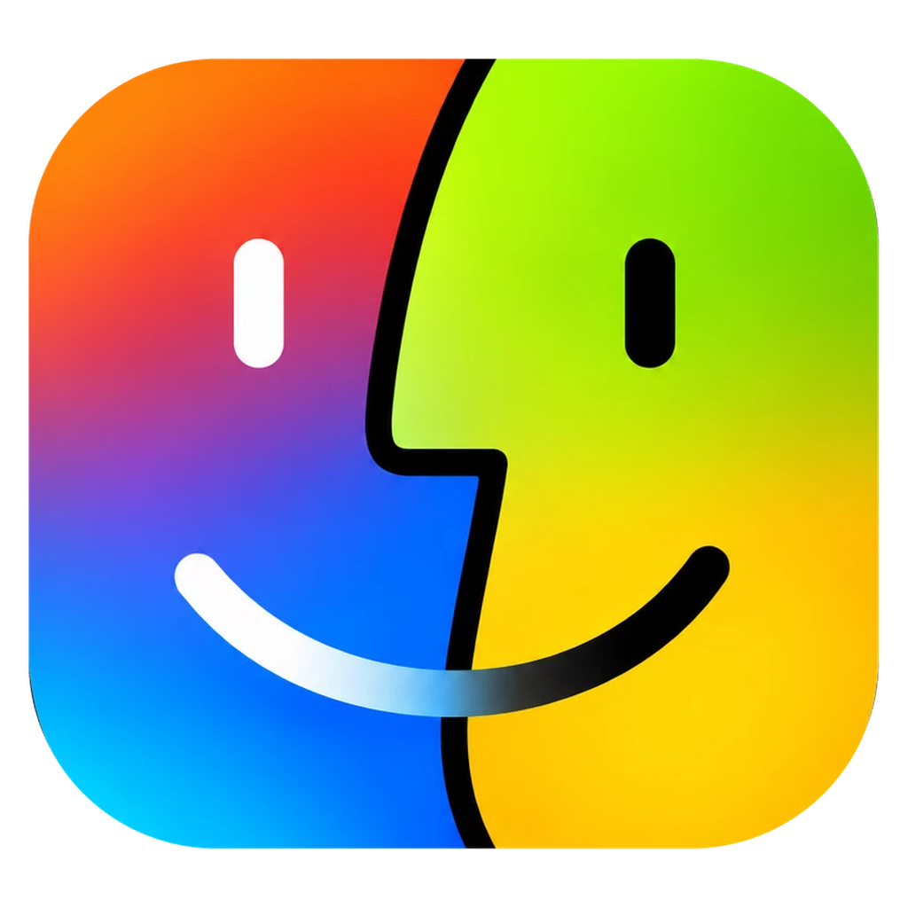</p>
<h1 align="center">DockOver</h1>
<p align="center"><a href="README.md">简体中文</a> · English</p>

DockOver brings a macOS-style Dock, menu bar, Control Center, Launchpad, and desktop widgets to Windows 11. Its Liquid Glass surfaces sample the desktop in real time.

[Download for Windows 11](https://github.com/Davizcbia/DockOver/releases/latest) · [1.3.0 release notes](docs/releases/1.3.0.md#english) · [DockDrop](https://github.com/Davizcbia/DockDrop) · [DockOver Music Player](https://github.com/Davizcbia/DockOver-Music-Player)

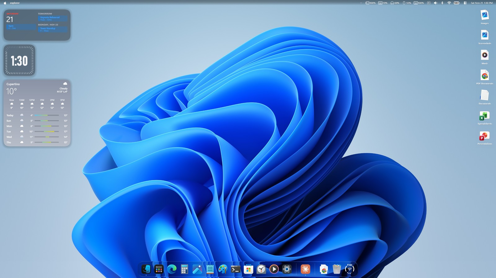

Screenshots use Windows wallpaper, built-in apps, and sample data.

## Dock

The Dock samples the desktop behind it. The GPU renders refraction, blur, and highlights as windows move. The Dock also supports adjustable pointer magnification, auto-hide, drag-to-pin, reordering, separators, Downloads stacks, the Recycle Bin, icon masks, and custom icons.

| Liquid Glass | Magnification |
| --- | --- |
| 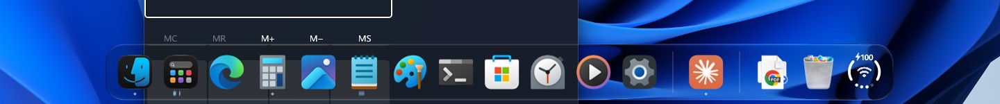 | 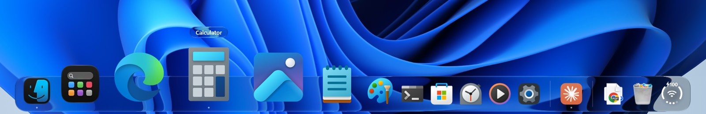 |
| **Context menu** for opening, renaming, removing, and editing icons | **Minimized windows** with Genie animation and live thumbnails |
| 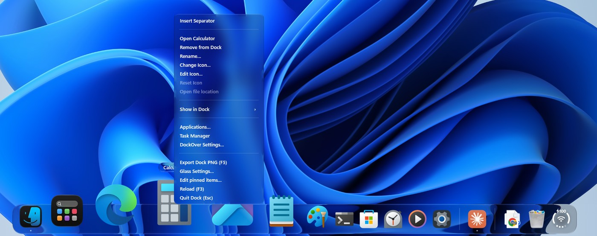 | 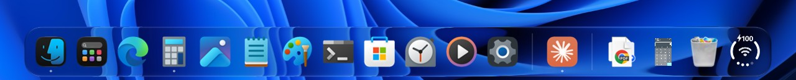 |

## Launchpad

Search a full-screen app grid, reorder apps by dragging, and group them into folders. Opening, paging, and folder transitions use spring animations.

| Launchpad | App folder |
| --- | --- |
| 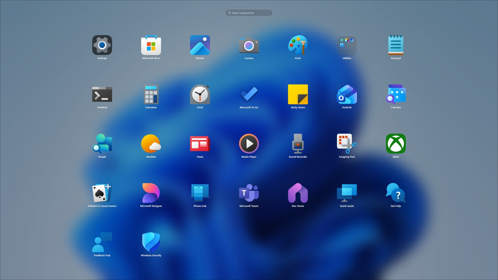 | 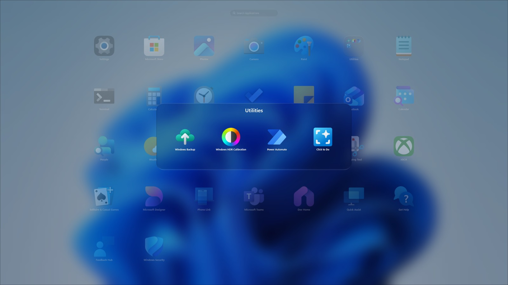 |

## Menu bar and Control Center

The menu bar shows the active app, tray icons, battery, Wi-Fi, Bluetooth, sound, and time. Control Center brings together network, display, sound, Do Not Disturb, and Now Playing controls. Notification Center and banners are also available.

| Control Center | Menu bar |
| --- | --- |
| 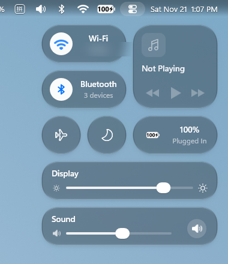 | 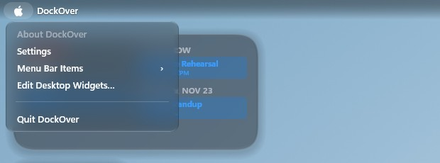 |

## Desktop widgets and Stacks

DockOver Desktop adds calendar, clock, weather, battery, and system widgets. Calendar supports ICS subscriptions. Widget glass follows the desktop wallpaper and can sample the music wallpaper. Stacks group desktop files by type or date and support dragging, opening, and Quick Look with the Space bar.

| Widget settings | Widget gallery | Open Stack |
| --- | --- | --- |
| 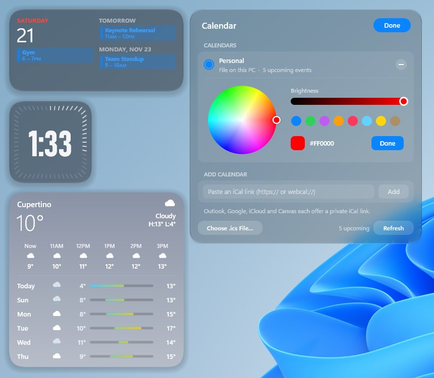 | 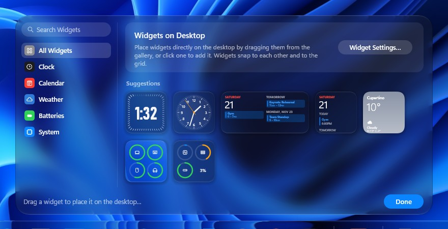 | 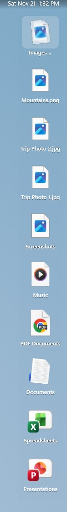 |

## Music wallpaper

Show the current album cover and synchronized lyrics on the desktop or open full-screen Now Playing. Motion artwork plays when available. Options include local music tags, sidecar LRC files, retaining artwork on pause, fitting the artwork between the Dock and menu bar, lyric timing, and music-reactive backgrounds. [Standalone Music Player](https://github.com/Davizcbia/DockOver-Music-Player)

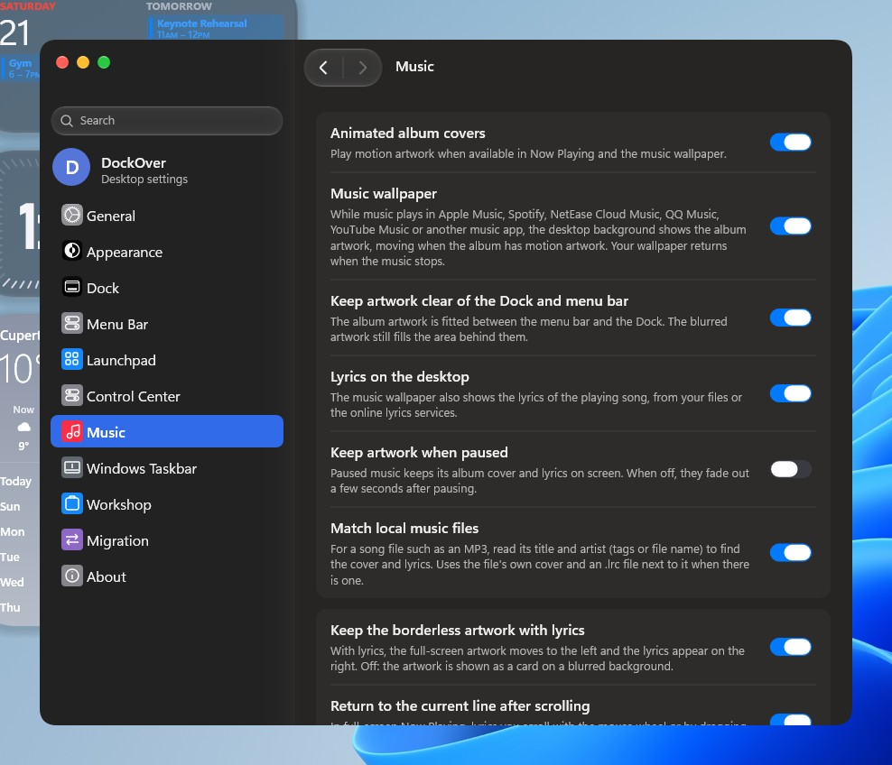

## DockDrop

Open DockDrop from the Dock context menu. On a phone, scan the pairing bubble or backup QR code in a browser to transfer files and text in either direction. After the first pairing, you can remember the phone for later reconnects. The DockOver Desktop staging widget accepts dragged files and pasted text. [Standalone DockDrop and screenshots](https://github.com/Davizcbia/DockDrop)

## Settings

Search Settings for appearance, animation, performance, low-latency glass, game compatibility, and update options. Select **English** or **简体中文** under **Appearance → Language**. The About page checks for updates from GitHub Releases.

| Appearance | About and updates |
| --- | --- |
| 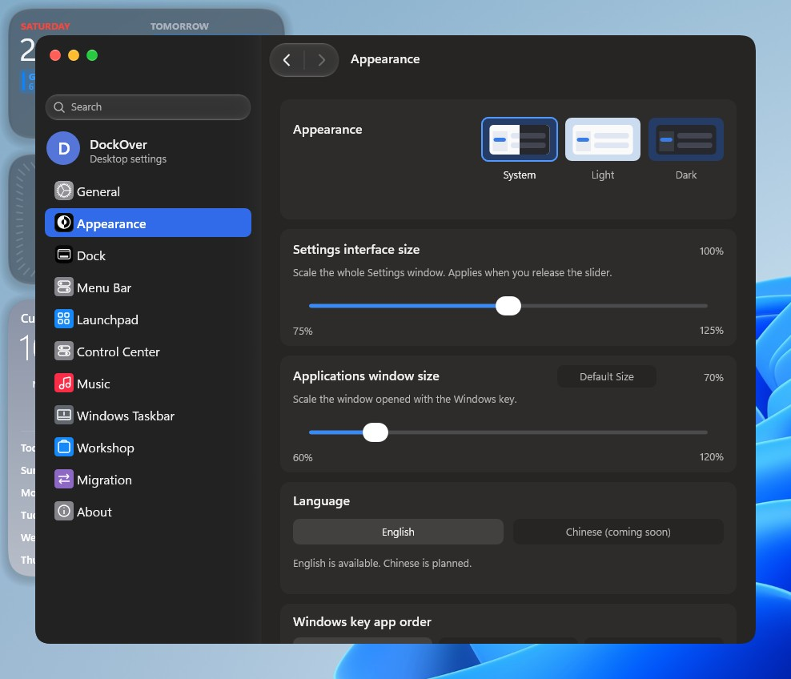 | 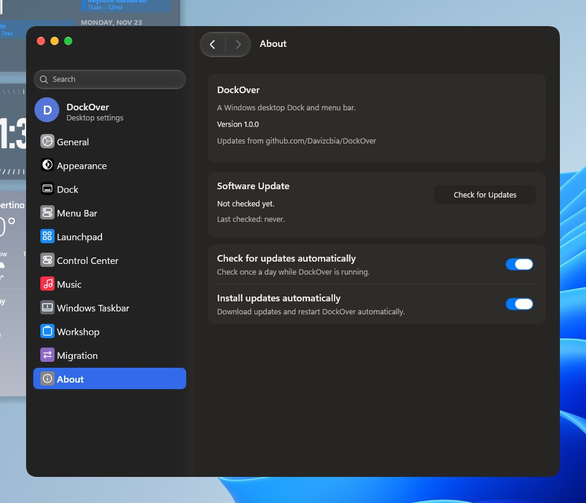 |

## Install

1. Download `DockOver-Windows-Portable-<version>.zip` and extract it. [Latest release](https://github.com/Davizcbia/DockOver/releases/latest)
2. Run `DockOver.exe` to start the Dock and menu bar. Running it again opens Settings.
3. Run `DockOver Desktop.exe` to start widgets and Stacks. To start it with DockOver, enable the option in **Settings → General**.

User data and logs are kept in `%LOCALAPPDATA%`. If DockOver hides the Windows taskbar, it restores it when it exits.

## Build

Use Windows 11, Visual Studio 2022 with Desktop development with C++, MSVC x64, a Windows SDK with `fxc`, CMake, and Ninja. The Applications menu also uses Qt 6 Widgets.

```bat
build_docky.cmd
```

The build output is in `build\`. The entry point is `build\LiquidDesktopManager.exe`.

```powershell
powershell -ExecutionPolicy Bypass -File package_docky.ps1 -Release
```

The release version is set by `DOCKY_VERSION` in `dockui/CMakeLists.txt`.

| Path | Contents |
| --- | --- |
| `dockui/` | DockOver source and packaging configuration |
| `dockui/docs/` | Design and implementation notes |
| `docs/screenshots/` | Product screenshots |
| `core/` and `liquid glass test/` | Qt/QML material experiments |
| `prototype/` | Early composition prototype |

The repository omits Apple fonts and system icon assets. The app includes its own default icons.
