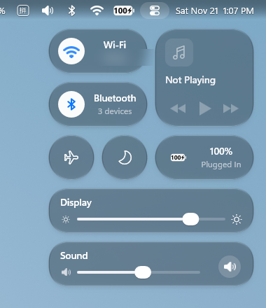
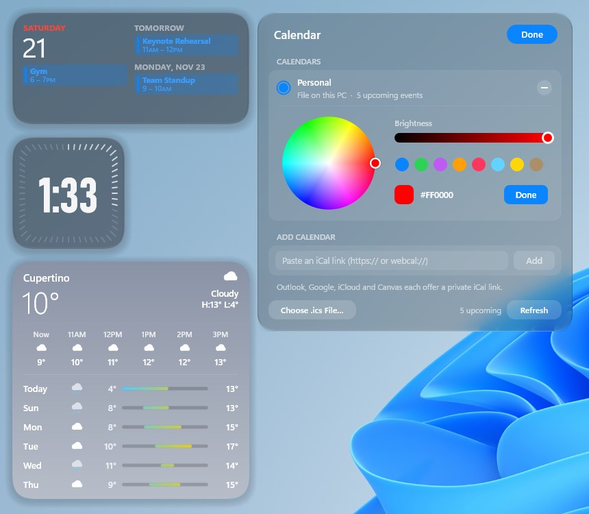
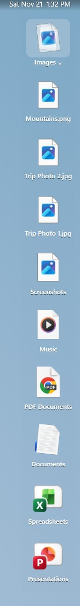
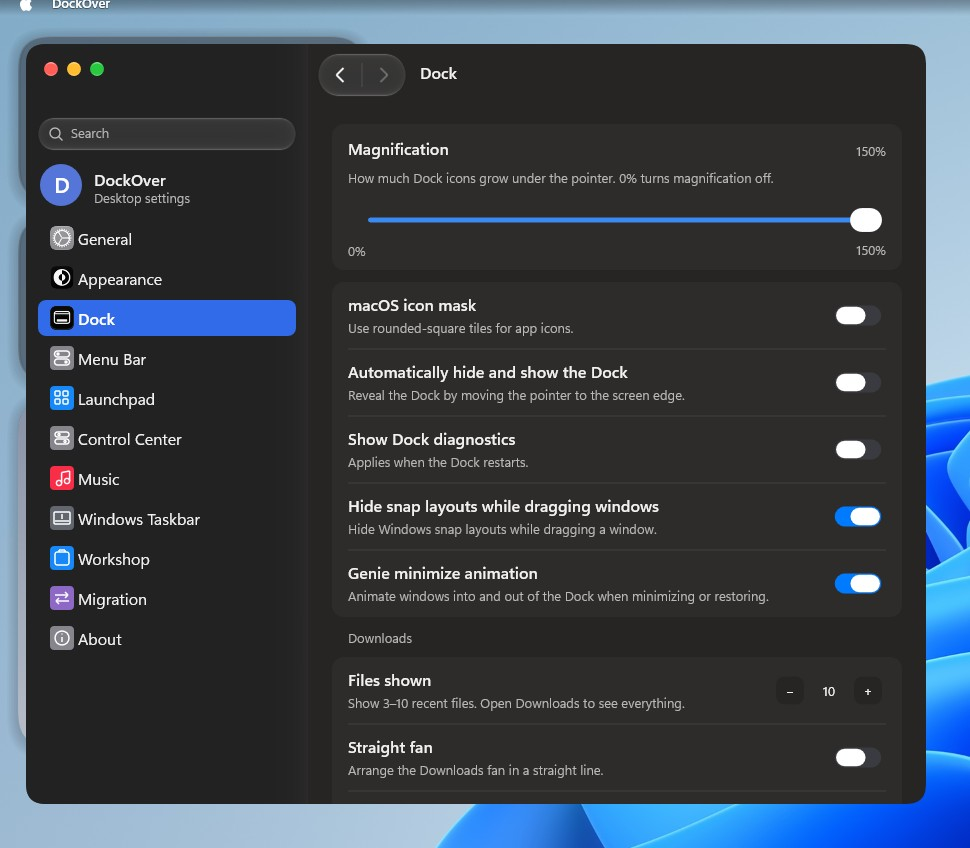
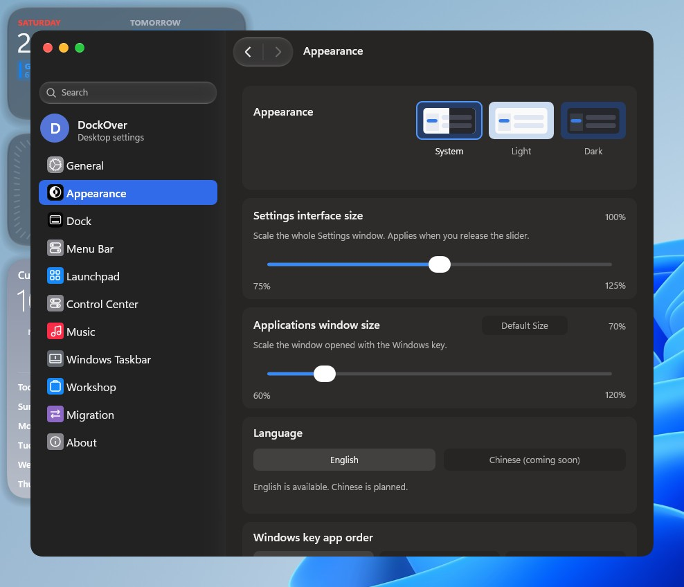

<p align="center">
  
</p>

<h1 align="center">DockOver</h1>

<p align="center">
  <b>Windows 11 上的 macOS 风格桌面：Dock、菜单栏、控制中心、Launchpad 和桌面小组件，全部是实时液态玻璃。</b><br>
  A macOS-style desktop for Windows 11 — Dock, menu bar, Control Center, Launchpad and widgets in live Liquid Glass.
</p>

<p align="center">
  <a href="https://github.com/Davizcbia/DockOver/releases/latest"></a>
  <a href="https://github.com/Davizcbia/DockOver/releases"></a>
  
  
</p>

<p align="center">
  <a href="#dock">Dock</a> ·
  <a href="#launchpad">Launchpad</a> ·
  <a href="#菜单栏与控制中心">菜单栏与控制中心</a> ·
  <a href="#桌面小组件与叠放">小组件</a> ·
  <a href="#音乐壁纸">音乐壁纸</a> ·
  <a href="#设置">设置</a> ·
  <a href="#安装">安装</a> ·
  <a href="#构建">构建</a>
</p>


<p align="center"><sub>截图均来自演示环境：Windows 默认壁纸、Windows 自带应用和示例数据。</sub></p>

---

## Dock

真正的液态玻璃：Dock 实时读取它身后的桌面，边缘折射、磨砂和高光都在 GPU 上逐帧计算，背后的窗口移动时立刻跟着变化。


| | |
| :-- | :-- |
|  | **右键菜单**：打开、移除、重命名、更换和编辑图标，在 Dock 中显示，直接打开任务管理器和 DockOver 设置。 |
|  | **最小化到 Dock**：Genie 动画，最小化的窗口以实时缩略图留在 Dock 右侧；Dock 重启后也不会丢。 |

- 放大效果 0–150% 可调，0% 即不放大；弹簧动画跟随指针，不掉帧。
- 运行指示、拖动排序、分隔符、自动隐藏、下载堆栈（扇形或网格）、回收站。
- macOS 风格图标遮罩、自定义图标和图标编辑器。

## Launchpad

全屏应用网格，可搜索、拖动排序、建文件夹。打开、翻页和文件夹都使用 Apple 风格的弹簧，翻页会接住手指滑动的速度。

| | |
| :-: | :-: |
|  |  |

## 菜单栏与控制中心

顶部菜单栏显示当前应用、托盘图标、设备电量、Wi-Fi、蓝牙、声音和时间。控制中心集中了 Wi-Fi、蓝牙、勿扰、亮度、音量和正在播放。所有弹窗点击别处或失去焦点即关闭。

| | |
| :-: | :-: |
|  |  |

还有通知中心和通知横幅；按 PrtScn 或 Win+Shift+S 截图时，所有玻璃窗口都会出现在截图里。

## 桌面小组件与叠放

**DockOver Desktop** 把小组件和桌面文件放在壁纸上：日历（.ics / Outlook / Google / iCloud 订阅）、时钟、天气、设备电量、系统状态。小组件的玻璃会跟着壁纸和音乐壁纸实时变化。

| | |
| :-: | :-: |
|  |  |

| | |
| :-- | :-- |
|  | **叠放（Stacks）**：桌面文件按类型自动归组，点击就地展开，可拖动、预览（空格键 Quick Look）和打开。一个快捷键同时隐藏小组件、叠放和 Windows 桌面图标。 |

## 音乐壁纸

播放音乐时（Apple Music、Spotify、网易云音乐、QQ 音乐、YouTube Music 等），桌面背景换成专辑封面和逐行滚动的歌词；有动态封面时播放动态封面。

- 读取本地 MP3 等文件的标题、歌手、内嵌封面和同名 `.lrc` 歌词，不联网也能匹配。
- 可设置暂停后保留封面和歌词；封面自动避开 Dock 和菜单栏。


## 设置

所有选项都在一个 macOS 风格的设置窗口里，支持搜索。

| | |
| :-: | :-: |
|  |  |
|  |  |

- **统一动效**：所有弹窗、菜单、面板使用同一套 Apple 风格弹簧参数（`dockui/src/motion.h` 的 `tokens`）。
- **性能**：帧率上限可调；全屏游戏时自动隐藏并暂停捕获和钩子；低延迟玻璃模式。
- **自动更新**：设置 → About，从 GitHub Releases 检查并安装更新。

## 安装

1. 从 [Releases](https://github.com/Davizcbia/DockOver/releases/latest) 下载 `DockOver-Windows-Portable-<版本>.zip`。
2. 解压到任意文件夹，运行 `DockOver.exe`。
3. 再次运行 `DockOver.exe` 会打开设置。小组件和叠放由 `DockOver Desktop.exe` 提供，默认随 Dock 一起启动。

便携版不需要安装运行库。设置、日志和用户数据保存在 `%LOCALAPPDATA%`，不写入程序文件夹。退出 DockOver 时会恢复 Windows 任务栏。

## 构建

需要 Windows 11、Visual Studio 2022（Desktop development with C++、MSVC x64、Windows 10/11 SDK，含 fxc）以及 VS 自带的 CMake 和 Ninja。

```bat
build_docky.cmd
```

输出在 `build\`，入口是 `build\LiquidDesktopManager.exe`。只编译，不会启动程序或修改任何设置。

打包便携版（与 Releases 相同的布局）：

```powershell
powershell -ExecutionPolicy Bypass -File package_docky.ps1 -Release
```

版本号在 `dockui/CMakeLists.txt` 的 `DOCKY_VERSION`。

## 目录

| 路径 | 内容 |
| --- | --- |
| `dockui/` | 主程序源码（C++20、Direct2D / Direct3D 11、DirectComposition）：Dock、菜单栏、Launchpad、控制中心、设置、Desktop、音乐壁纸、更新器 |
| `dockui/docs/` | 设计与实现文档 |
| `docs/screenshots/` | 本页截图 |
| `core/`、`liquid glass test/` | 液态玻璃材质的 Qt/QML 实验台和着色器（参考用，不是主程序入口） |
| `prototype/` | 早期合成原型 |

## 资源说明

本仓库不包含 Apple 的字体或系统图标资源。个人参考用的扩展包（`.dockypack`）和描摹图标没有再分发授权，不在仓库中；程序在没有它们时使用自带图标。
