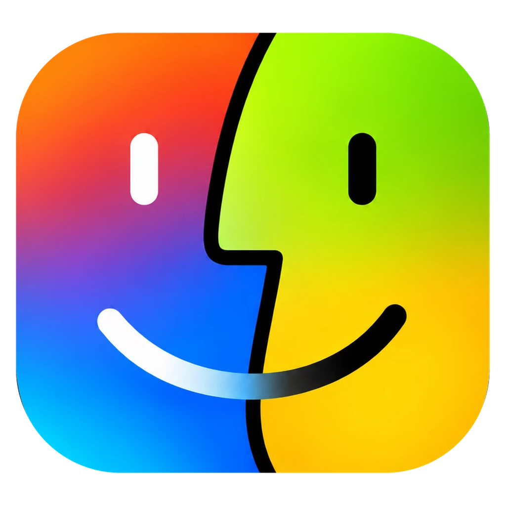
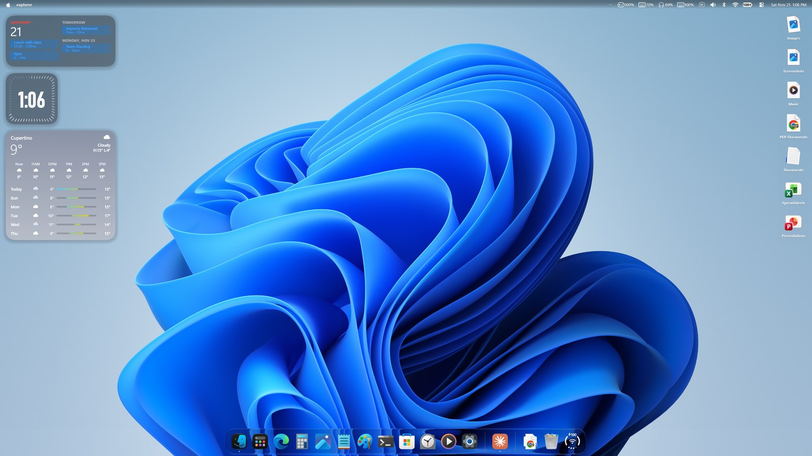
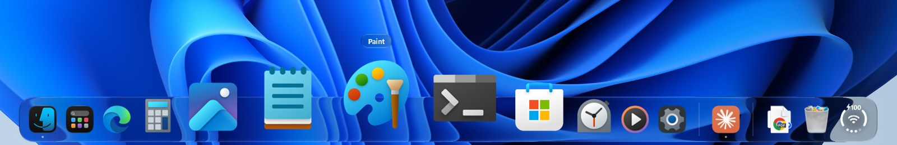
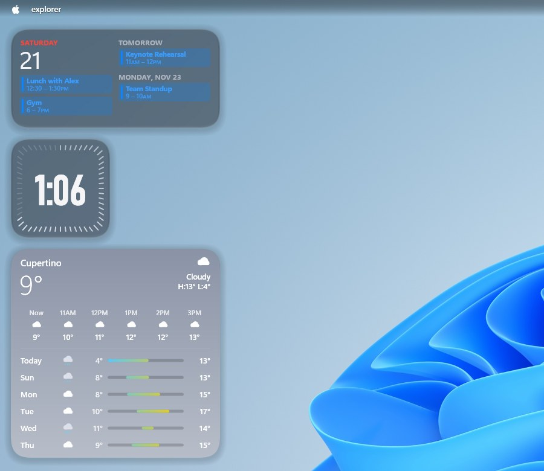
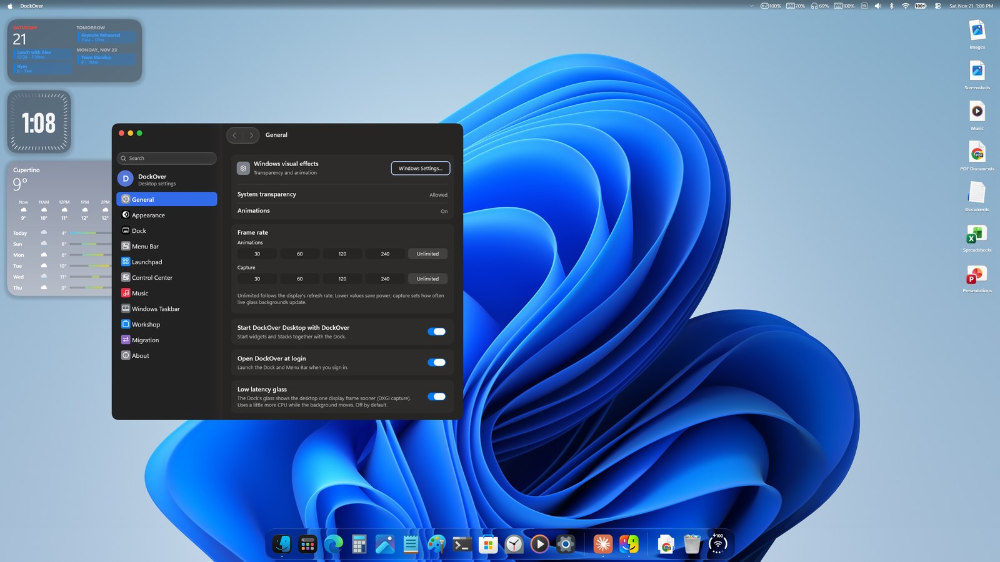

<p align="center">
  
</p>

<h1 align="center">DockOver 1.0</h1>

<p align="center">
  Windows 11 上的 macOS 风格 Dock、菜单栏、控制中心和桌面小组件，全部使用实时液态玻璃（Liquid Glass）材质。<br>
  A macOS-style Dock, menu bar, Control Center and desktop widgets for Windows 11, rendered in live Liquid Glass.
</p>

<p align="center">
  <a href="https://github.com/Davizcbia/DockOver/releases/latest"><b>下载 / Download</b></a> ·
  <a href="#功能">功能</a> ·
  <a href="#构建">构建</a>
</p>



## 功能

| | |
| --- | --- |
|  | **Dock**：图标放大（设置里可调 0–150%）、Genie 最小化动画、最小化窗口缩略图、运行指示、拖动排序、下载堆栈、右键菜单（含任务管理器）。 |
|  | **菜单栏和控制中心**：Wi-Fi、蓝牙、声音、亮度、正在播放、托盘图标、通知中心。弹窗失去焦点即关闭。 |
|  | **DockOver Desktop**：日历（.ics 订阅，色盘选色）、时钟、天气、电池等小组件，桌面文件按类型自动叠放（Stacks）。玻璃跟随壁纸和音乐壁纸实时变化。 |

更多：

- **Launchpad**：全屏应用网格、文件夹、搜索，页面切换带惯性弹簧。
- **音乐壁纸**：播放时用专辑封面和滚动歌词做桌面背景；可读取本地 MP3 等文件的标签、封面和 `.lrc` 歌词；可设置暂停后保留。
- **统一动效**：所有弹窗、菜单、面板使用同一套 Apple 风格弹簧参数（`dockui/src/motion.h` 的 `tokens`）。
- **截图友好**：按 PrtScn 或 Win+Shift+S 时，玻璃窗口会临时出现在截图里。
- **游戏兼容**：全屏游戏时自动暂停捕获和钩子。
- **自动更新**：设置 → About 检查 GitHub Releases。



## 安装

1. 从 [Releases](https://github.com/Davizcbia/DockOver/releases/latest) 下载 `DockOver-Windows-Portable-1.0.0.zip`。
2. 解压到任意文件夹，运行 `DockOver.exe`。
3. 再次运行 `DockOver.exe` 打开设置。小组件和桌面叠放由 `DockOver Desktop.exe` 提供，默认随 Dock 一起启动。

便携版不需要安装运行库。设置、日志和用户数据保存在 `%LOCALAPPDATA%`，不会写入程序文件夹。

## 目录

| 路径 | 内容 |
| --- | --- |
| `dockui/` | 主程序源码（C++20、Direct2D/Direct3D 11、DirectComposition）：Dock、菜单栏、Launchpad、控制中心、设置、Desktop、音乐壁纸、更新器 |
| `dockui/docs/` | 设计与实现文档 |
| `docs/screenshots/` | 本页截图（演示环境：Windows 默认壁纸和示例数据） |
| `core/`、`liquid glass test/` | 液态玻璃材质的 Qt/QML 实验台和着色器（参考用，不是主程序入口） |
| `prototype/` | 早期合成原型 |

## 构建

需要 Windows 11、Visual Studio 2022（Desktop development with C++、MSVC x64、Windows 10/11 SDK，含 fxc）以及 VS 自带的 CMake 和 Ninja。

```bat
build_docky.cmd
```

输出在 `build\`，入口是 `build\LiquidDesktopManager.exe`。只编译，不会启动程序或修改任何设置。

打包便携版（与 Releases 相同的布局）：

```powershell
powershell -ExecutionPolicy Bypass -File package_docky.ps1 -Release
```

版本号在 `dockui/CMakeLists.txt` 的 `DOCKY_VERSION`。

## 资源说明

本仓库不包含 Apple 的字体或系统图标资源。个人参考用的扩展包（`.dockypack`）和描摹图标没有再分发授权，不在仓库中；程序在没有它们时使用自带图标。
